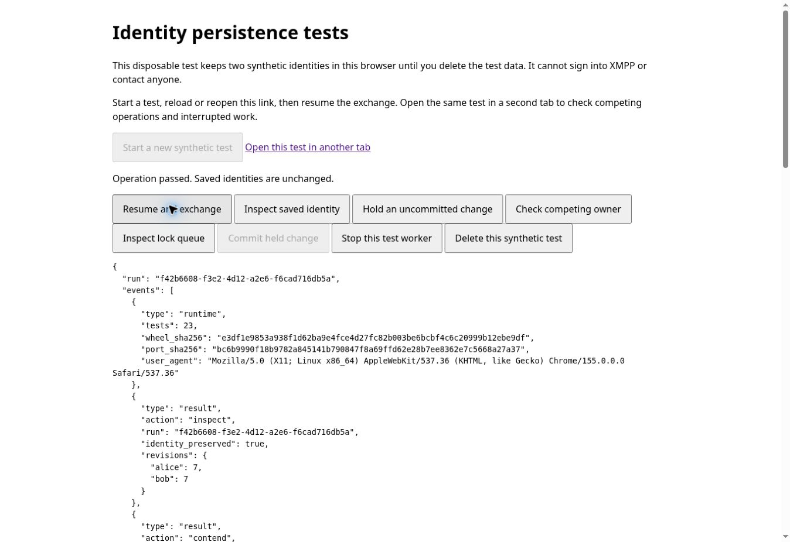

# Browser lifecycle verification

The private harness exposes `lifecycle.html` for testing the actual browser
storage implementation across page/worker boundaries. It uses two synthetic
identities and has no XMPP transport, credentials or contact access.

Each run has a random UUID in its page URL. Only that run's two disposable
databases are touched. Private SQLite snapshots stay in the snapshot repository;
the companion fixture record holds public bundles and expected identity
fingerprints. No production outbox or account-reset behavior is implemented here.

## Checks

The latest result is shown directly above the controls with a result number and
saved revisions. Repeated inspections increase the result number, not the saved
revisions; only an exchange advances both sessions. Worker startup clears the
previous completion status and shows elapsed progress. A slow operation is not
automatically cancelled or retried. The detailed JSON remains below the controls.

1. Start a new synthetic test. The initial exchange establishes sessions in both
   directions. Save the displayed revisions.
2. Reload the page. Opening an existing URL only inspects saved state; it never
   generates replacement identities. Resume and exchange. Both messages must
   decrypt with the original identities and continued sessions.
3. Close the page and reopen the same test link. Inspect and exchange again.
4. Open that test in another tab. Hold an uncommitted change in one tab. This
   advances a ratchet in a disposable working copy, then waits **before** the
   repository commits it. The competing-owner check in the other tab must
   report `STORAGE_BUSY` without stealing the lock.
5. Queue an exchange in the other tab. Inspect the lock queue in the owner tab;
   it should show one held and one pending lock for this run. Close the owner
   tab. The queued exchange must continue from the revision recorded before
   the interrupted change and decrypt successfully.
6. Repeat the held/queued test but commit the held change. The other tab must
   load the next committed revision, then exchange successfully. The held
   ciphertext is intentionally discarded in this synthetic test, so the peer
   must also cope with that missed synthetic message.
7. Stop a worker while it holds an uncommitted change, then resume it. Check
   saved revisions and successful decryption; worker termination alone is not
   reported as proof of safe recovery.
8. Close other test tabs and delete this synthetic test using its button.

The harness stops its worker on `pagehide`, including entry into the back/forward
cache, and starts a fresh worker on a persisted `pageshow`. This prevents an
inactive page from retaining its test worker's account lock. The production
worker/coordinator integration still needs to adopt and verify lifecycle policy.

The fixture uses a 30-second acquisition timeout for manual queued-handoff tests;
the repository's production default remains 10 seconds. One worker accepts one
operation at a time. Different pages use separate WASM runtimes and coordinate
through the actual repository's account locks.

## Evidence boundaries

### Actual Chrome result

Chrome 155 on Linux passed the sequence above over private HTTPS with real
IndexedDB and Web Locks. The tested source was
`3551c4d304f5be2fd0ac690d2878bafe1dbac771`, packaged as QA source
`1403adae7a5b88cd40cd28a458144863ffb5b858`. Each fresh worker also passed the
23-test WASM baseline; the crypto wheel and adapter archive hashes were unchanged.

The [raw captures](evidence/chrome-lifecycle.json) record the visible page reports
alongside the actual page/worker actions. Revisions below are Alice/Bob:

| Observed action | Saved state / outcome |
| --- | --- |
| Create the synthetic pair | 3 / 3 |
| Reload page, inspect, then exchange | 3 / 3 retained; 5 / 5 after exchange |
| Close tab, reopen same URL, then exchange | 5 / 5 retained; 7 / 7 after exchange |
| Competing operation while another tab holds a change | Blocked; lock not stolen |
| Close uncommitted owner with another exchange waiting | Exchange starts at 7 / 7; ends at 9 / 9 |
| Commit owner with one held and one pending lock observed | Owner commits Alice 10; waiting exchange loads 10 / 9 and ends at 12 / 11 |
| Repeat owner closure with explicit held/pending queue evidence | Uncommitted Alice 12 change discarded; waiting exchange starts at 12 / 11 and ends at 14 / 13 |
| Stop worker during another uncommitted change, restart and inspect | 14 / 13 retained |
| Exchange after worker restart | 16 / 15; both messages decrypted |
| Delete the completed synthetic run | Cleanup confirmed |

Every completed exchange retained both original identity descriptors and used
continued sessions. The first owner-closure capture preceded the asynchronous
queue report, so the closure check was repeated with explicit one-held/one-pending
evidence. A browser-control wait also expired while a fresh worker was loading;
the subsequent page report confirmed successful initialization and inspection.
Neither event is counted as an application failure or an additional passed test.

The [fresh-build CI run](https://github.com/tobiko-dev/Monal/actions/runs/41777981708)
also passed the 16 simulated storage tests, 23 WASM tests, existing integration
fixture, new lifecycle-fixture integration check and altered-archive rejection.
The Node fixture reconstructs objects; the actual browser captures above are the
evidence for page reload/closure and separate workers.

### Remaining limits

Node tests validate fixture setup, reconstruction, contention and continued
ratchets against simulated IndexedDB. They do not prove tab closure or reload.
Browser evidence must record actual page actions and the resulting reports.
Full browser-process crash, OS suspension, storage eviction, private browsing,
and physical iPad Safari remain separate checks even when these Chrome tests
pass. This test UI is not the messaging application's interface.
