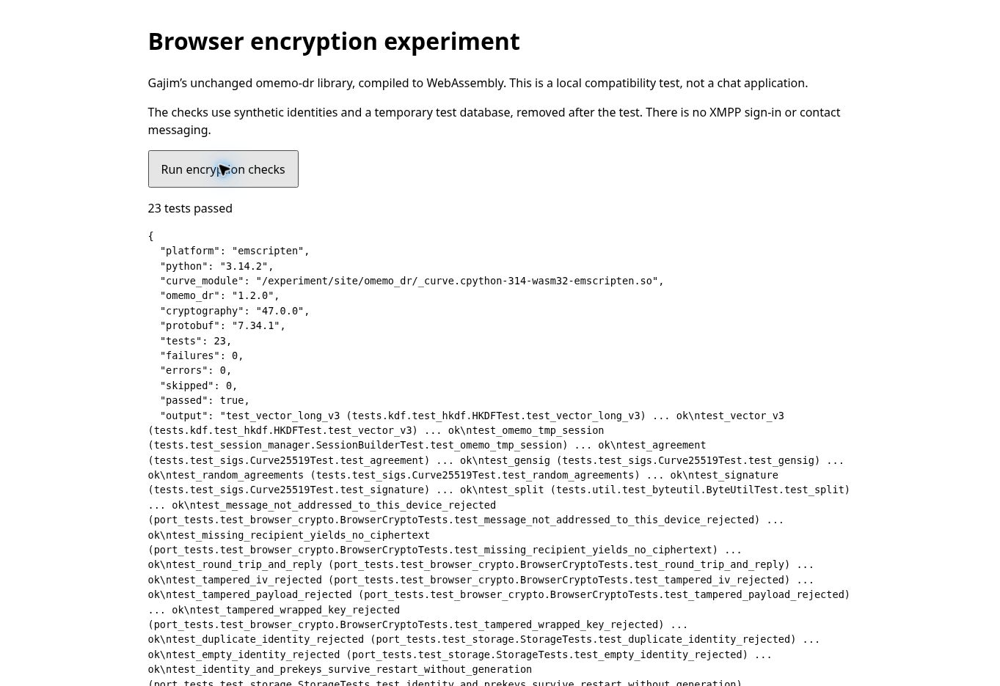
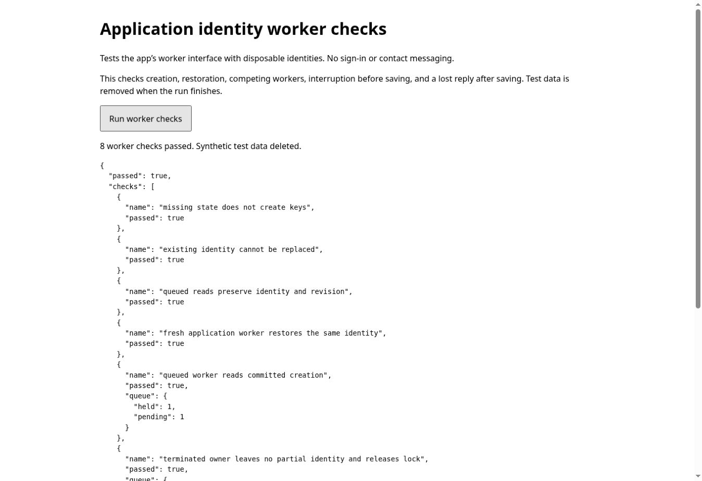
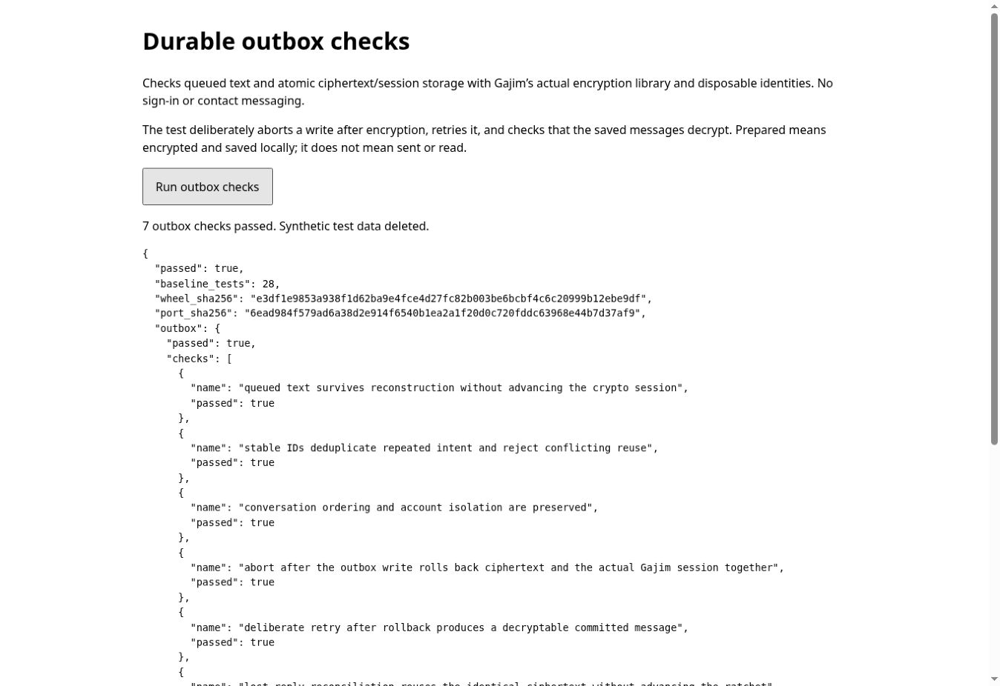
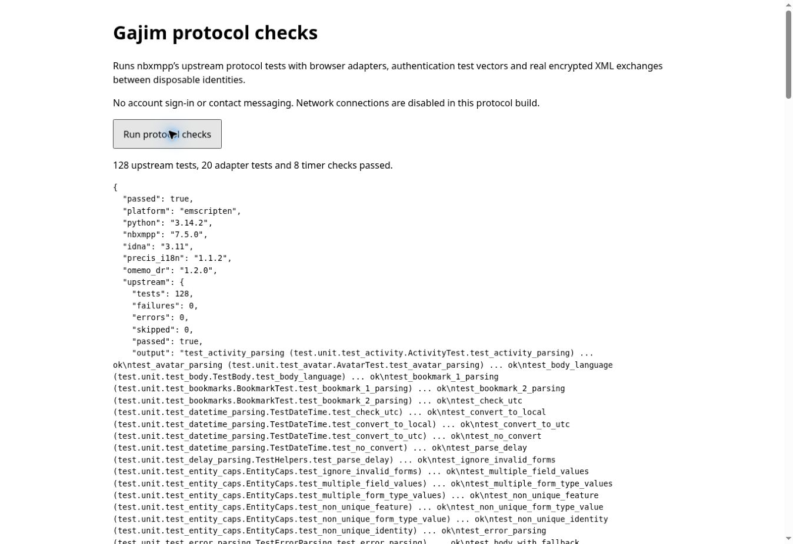
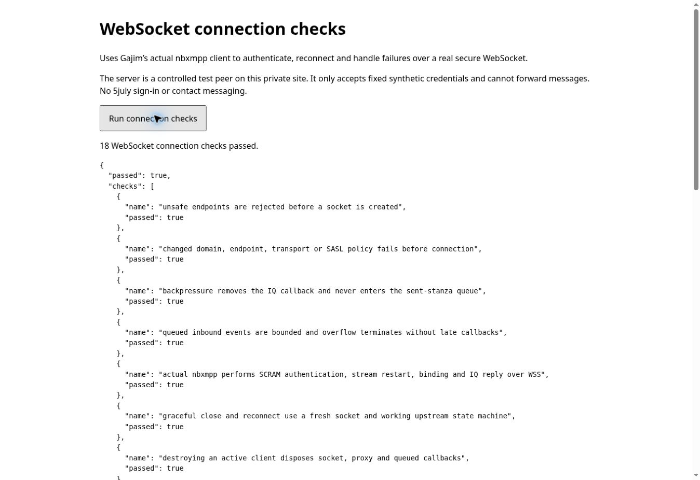

# Foundation validation — 2026-11-04

## Earlier encryption/storage baseline

- Built the unchanged omemo-dr 1.2.0 C extension as `cp314-cp314-pyemscripten_2026_0_wasm32` and checked its actual WebAssembly magic bytes.
- Ran 8 unchanged upstream tests, 6 crypto checks and 9 Gajim storage checks in Pyodide 314.0.7, hosted by Node 24.22.1. **23 passed, 0 failed, 0 errors, 0 skipped.** [Storage baseline result](evidence/node-wasm-storage.json); [earlier 14-test M1 result](evidence/node-wasm.json). The identity-worker increment below increases this suite to 28 tests.
- The nine storage checks also passed on native Python. They retain the device identity, prekeys, peer trust and working ratchets after reconstructing the stores/session managers; corrupt, missing, mismatched and unsupported snapshots are rejected.
- Passed all **16** JS repository tests against simulated IndexedDB and Node Web Locks, including quota/denied storage, concurrent writers, stale revisions, identity replacement attempts, lock timeout and an abort after the write request succeeds.
- Completed **three encrypted exchanges** through WASM, the adapted Gajim store and the JS repository with reconstructed objects. These combined checks use synthetic identities and explicit synthetic trust; no XMPP transport exists yet.
- Repeated all **23 WASM tests and three encrypted exchanges in actual Chrome 155 on Linux**, served over private HTTPS. Real browser IndexedDB and Web Locks were used. Zero failures/errors/skips; the device identities remained consistent through reconstructed stores/managers. [Raw browser result](evidence/chrome-browser.json).
- Verified actual Chrome page reload, tab close/reopen, competing-tab handoff after owner commit or uncommitted closure, and worker termination/restart. The same identities and continued encrypted sessions survived every completed exchange; recorded revisions distinguish committed changes from discarded working copies. [Procedure and revision table](lifecycle.md), [raw captures](evidence/chrome-lifecycle.json).
- Confirmed Python 3.14.2, cryptography 47.0.0, protobuf 7.34.1 and the loaded WASM curve-module path in the test result.
- Source archive, runtime files and runtime package hashes are checked before packaging. The crypto source remains unchanged. Gajim's original SQLite file is hash-checked, then adapted with three explicit substitutions recorded in [the storage patch ledger](storage.md).
- Fresh local builds and [the M1 GitHub Actions run](https://github.com/tobiko-dev/Monal/actions/runs/41624574387) produced the identical wheel SHA-256: `e3df1e9853a938f1d62ba9e4fce4d27fc82b003be6bcbf4c6c20999b12ebe9df`. The M2 local build retains that hash; storage code is packaged separately.
- The actual runner rejects altered `checks.zip` and `port.zip` archives at their hash-check boundary, restoring the originals afterwards.
- The generated harness is about 16.5 MB before transfer compression; the runtime and dependencies account for about 16.2 MB. This is asset size, not memory usage.
- One Node observation: runtime startup 1.75 seconds; package loading plus checks 1.77 seconds; the 14 tests themselves 0.75 seconds. These are observations in this Linux environment, not iPad performance estimates.

## Actual browser verification and device limits

The authenticated HTTPS harness at `https://gajim-browser-qa.strongcaterpillar.chatgpt.site/` passed in the actual cloud Chrome browser. It served source commit `bc23461062b7f571a2da915154bfc5b5ed9b3656`, packaged as QA source commit `5ed48711654197b2b450318ceebcfeb911eff545`. Browser wheel, adapter-archive and source hashes match the Node/CI evidence. No browser security setting or application code was changed to obtain this pass.

One observation: 4.10 seconds runtime startup, 3.30 seconds package loading plus Python checks, and 1.09 seconds for those 23 tests themselves. The report's elapsed time excludes the subsequent storage integration fixture. These are cloud Chrome observations, not iPad estimates; memory usage was not measured.

The earlier HTTP preview at `http://terminal.local:4173/` stopped at the secure-context check. Moving this synthetic harness to private HTTPS resolved that environment limitation. The [earlier screenshot](evidence/secure-context-check-1793703790137.jpg) remains historical evidence.

The separate lifecycle harness retains synthetic data across visits until its explicit cleanup. Its actual Chrome run used source `3551c4d304f5be2fd0ac690d2878bafe1dbac771`, packaged as QA source `1403adae7a5b88cd40cd28a458144863ffb5b858`. Reload and close/reopen preserved saved identities and session state. One held/one pending lock was observed before both committed handoff and a repeated uncommitted owner closure. Worker termination before commit also preserved the prior revision, and a fresh worker decrypted subsequent messages. [Full lifecycle evidence and limitations](lifecycle.md).

The physical iPad Safari reports below cover selected lifecycle scenarios, including user-reported lock/unlock and Safari relaunch continuation. A separate reload, queued handoff after owner commit, process crash during active work, storage eviction and confirmed OS suspension remain pending. The 16 fault-injection/concurrency tests still have Node evidence only. The [lifecycle source CI run](https://github.com/tobiko-dev/Monal/actions/runs/41777981708) passed its fresh build, all 16 JS and 23 WASM tests, both integration fixtures and altered-archive rejection.

## User-reported physical iPad Safari results

The user supplied two successful Safari 26.6 baseline reports and lifecycle
reports; [selected fields and transcribed events](evidence/safari-user-reported.json)
retain their provenance. Both baselines pass all 23 tests with zero failures,
errors or skips, plus three encrypted exchanges through actual browser storage.
The crypto wheel and adapter hashes match the tested Chrome/CI artifacts.

The lifecycle report loads an existing fixture at Alice/Bob revisions 3/3,
exchanges to 5/5 and 7/7, then commits a held Alice change to 8/7. A subsequent
bidirectional exchange succeeds at 10/9. Both identities remain unchanged.
The unequal revisions are expected: the held operation advances only Alice.
The two initial queue inspections show an idle queue. Subsequent reports show
the owner holding an uncommitted Alice change at revision 10 and a second tab
receiving `STORAGE_BUSY` during inspection, then passing the competing-owner
check without stealing the lock. In response to the directed owner-close test,
the user supplied a successful exchange from 10/9 to 12/11 with unchanged
identities. This matches recovery from the last committed state; the held
working-copy change was not persisted. This is user-reported owner-close
evidence, not an independently controlled Safari run. No owner queue snapshot
showing one held/one pending lock was supplied.

In response to instructions to save the full test URL, close the remaining tab,
reopen that URL and resume, the user supplied a fresh runtime report for the same
run. Its startup inspection restores 12/11 with unchanged identities, followed
by two successful encrypted exchanges reaching 14/13. This is recorded as
user-reported continuation after the directed close/reopen test; the report
does not independently instrument the navigation action.

In response to instructions to switch apps, lock the iPad for about a minute,
unlock it and resume in Safari, the user supplied the same run's event history
with one further successful bidirectional exchange from 14/13 to 16/15. Both
identities remain unchanged and the artifact hashes match. This is recorded as
user-reported continuation after app switching and lock/unlock. No new runtime
event or suspension instrumentation is present; the report does not establish
whether iPadOS suspended or terminated the browser or worker.

In response to instructions to dismiss Safari in the iPad app switcher, reopen
Safari and resume the same run, the user supplied a fresh runtime report. Its
startup inspection restores 16/15, followed by two successful encrypted
exchanges reaching 18/17. Identities and artifact hashes remain unchanged.
This is recorded as user-reported Safari app relaunch recovery while no
operation was deliberately held. The report does not independently establish
which WebKit processes terminated or exercise interruption during a write.

Queued handoff after an owner commit, a separate explicit reload, confirmed
OS suspension and process-crash recovery during active work remain open.

Reported startup values are 68,848 ms and 37,989 ms; the separate elapsed fields
are 184,792 ms and 2,900 ms. Python tests themselves take 0.365 and 0.366 seconds.
These phases must not be presented as a single complete launch measurement.
Network and cache effects were not isolated, and memory use was not measured.

## Application identity worker increment

The [application identity API](identity-worker.md) now creates and reopens
actual Gajim identities inside a serialized worker service. Thirty JS tests pass
against simulated IndexedDB, including interruption, late abort and lost commit
acknowledgement. The five new Python bridge tests pass natively and in WASM;
the WASM suite now totals **28 passed, 0 failed, 0 errors, 0 skipped**.
The existing storage and lifecycle fixtures still pass. A new combined service
check creates an identity using Gajim's 100-prekey configuration, exchanges four
synthetic encrypted messages, and reopens the same identity between exchanges.
[Raw Node WASM evidence](evidence/node-wasm-identity-worker.json).

The unchanged crypto wheel retains its prior hash. The adapter archive changes
to `6ead984f579ad6a38d2e914f6540b1ea2a1f20d0c720fddc63968e44b7d37af9`.
Earlier Safari reports apply to the earlier adapter/worker.

Source `54368f6b9e339bf9e70a67aad07b20785df23da4`, deployed as private QA source
`be1722b28ef902d995a4c6dd5e4359b076bbef4d`, passed all **eight application worker
checks in actual Chrome 155** using real module workers, IndexedDB, Web Locks
and the Gajim WASM bridge. The cases cover missing state, explicit creation,
duplicate creation rejection, queued reads, fresh-worker restoration, queued
handoff after commit, termination before commit, and recovery after a saved
identity's reply is lost. The two competing-worker cases each observed one
held and one pending lock. All disposable databases were removed after the run.
[Raw browser result](evidence/chrome-identity-worker.json).

A synthetic lifecycle fixture created by the previous deployment was reloaded
after this deployment. The new 28-test runtime restored Alice/Bob revisions
3/3, then exchanged two encrypted messages to reach 5/5 with unchanged
identities. The fixture was deleted after evidence capture. This verifies this
specific adapter upgrade; it does not establish arbitrary upgrade/rollback
safety. [Before/after browser capture](evidence/chrome-identity-upgrade.json).

The [source CI run](https://github.com/tobiko-dev/Monal/actions/runs/41792951304)
passed its fresh WASM build, 30 JS tests, 28 WASM tests, combined integration
fixtures and altered-archive rejection. The subsequent user-reported Safari
worker results below cover this changed boundary; the earlier lifecycle results
are not relabeled as application-worker passes.

## Durable outbox increment

The [outbox storage/service boundary](outbox.md) adds stable queued intent,
explicit blocked preparation/retry, conversation ordering and atomic
ciphertext/session commits. All **50 JS tests** pass (20 new outbox checks plus
the existing 30). These use simulated IndexedDB and Node Web Locks.

The unchanged **28 WASM tests** and earlier integration fixtures still pass.
Seven new shared integration checks run actual Gajim/omemo-dr encryption,
abort a transaction after its outbox write, verify that both the session and
queue rolled back, retry and decrypt, and reconcile a discarded successful
reply without repeating encryption. Four committed synthetic messages decrypt;
one preparation is deliberately discarded. [Raw Node evidence](evidence/node-wasm-outbox.json).

IndexedDB version 2 adds the queue store in place. A v1 fixture preserves its
identity/revision during the simulated upgrade, and an older v1-only writer
cannot reopen the upgraded database. The crypto wheel and Python adapter
archive hashes are unchanged. The synthetic fixture archive adds variable
test text; this does not alter the upstream crypto or production Python code.

Source `bb54a29edd96a8f7b0d134335020411f061a2d59`, deployed as private QA source
`17aa76af3ab22236205661c94514d5fb5bc6c384`, passes **seven outbox checks in actual
Chrome 155** with real IndexedDB/Web Locks in a dedicated worker. The transaction
abort is injected after the native outbox write succeeds. Its rollback/retry,
decryption and ciphertext-reuse assertions pass. The **eight application identity
worker checks** also pass with database version 2, including termination and
queued ownership cases. [Raw browser evidence](evidence/chrome-outbox.json).

A fixture created by the previous v1-schema deployment was reloaded after
deployment. Inspection restored Alice/Bob revisions 3/3; two encrypted exchanges
continued to 5/5 with unchanged identities. All completed synthetic databases
were deleted. The same evidence file retains the before/after reports.

The [source CI run](https://github.com/tobiko-dev/Monal/actions/runs/41800990712)
passed. Object reconstruction and discarded replies in the outbox fixture are
not OS crash tests. Subsequent physical iPad results are recorded below. The new
queue is not yet bound to production recipient policy, a page messaging worker,
a composer or a network dispatcher.

## User-reported Safari application-worker and outbox results

On 2026-11-04 the user supplied successful physical iPad Safari 26.6 reports
for both new harness pages. [Transcribed reports and provenance](evidence/safari-worker-outbox-user-reported.json)
retain the exact check names, outcomes, reported timing and runtime fields.
These are user-supplied results, not independently controlled Safari tests.

All **eight application identity-worker checks** pass in **22,430 ms**. They
cover missing-state rejection, creation without replacement, queued reads,
restoration through a fresh worker, queued handoff after committed creation,
termination before saving, explicit creation after that interruption, and
recovery after a saved creation loses its reply. Both competing-worker checks
report one held and one pending lock. This establishes committed-creation
handoff for the application worker; it does not retroactively complete the
separate lifecycle harness's held-session-change handoff procedure.

All **seven durable outbox checks** pass in **3,314 ms**, with **28 baseline
tests**, **four encrypted exchanges**, **one discarded preparation** and
unchanged identities. The wheel and adapter SHA-256 values match the tested
build. The tests exercise actual worker/IndexedDB/Web Locks behavior and actual
Gajim crypto, including rollback after an injected write abort, retry/decryption
and ciphertext reuse after a discarded successful reply. Both pages report
that disposable test data was deleted. The identity report does not include
artifact hashes; the outbox report does.

These results complete the specified iPad worker/outbox checks, without
establishing live XMPP interoperability, production trust policy, process-crash
recovery during active work, actual storage eviction or quota exhaustion.
The worker test stops a worker; the queue test reconstructs storage objects.
Neither operation is equivalent to an iPadOS/WebKit process crash.

## Offline nbxmpp protocol-core increment

The pinned nbxmpp core now imports and executes through explicit browser
adapters, with no fake GI runtime. Both native Python 3.12.14/Linux and
Node 24.22.1 / Pyodide 314.0.7 / Python 3.14.2 pass **128 unchanged upstream
tests, 20 adapter/security tests and eight asynchronous checks**, with zero
failures/errors/skips and no leftover timers.
[Native result](evidence/native-nbxmpp.json),
[WASM result](evidence/node-wasm-nbxmpp.json),
[patch ledger](evidence/nbxmpp-adaptation.json).

The checks cover actual OMEMO bundle/message XML and unchanged omemo-dr crypto,
a bidirectional exchange across session restoration, payload tampering and
wrong-device rejection. Upstream address/XML/SASL tests remain unchanged.
Added tests include WebSocket-mode XML attacks, strict URI decoding,
SCRAM-SHA-256's RFC 7677 vector, SHA-1/256/512 derivation reference values and
bounded work rejection. Actual nbxmpp client disposal and IQ timeout/cancel
behavior run on asyncio natively and Pyodide WebLoop in WASM.

The WASM runtime lacked hashlib's PBKDF2 function. The adapter uses the existing
pinned cryptography library and bounds server-requested work; it does not
implement new cryptography or modify omemo-dr. Details and policy limits are in
[the protocol document](nbxmpp-port.md).

All **50 JS tests** and **28 existing WASM tests**, storage/lifecycle/identity
integration checks and **seven outbox checks** still pass.
[Crypto/storage regression report](evidence/node-wasm-protocol-regression.json).
[Integrity checks](evidence/nbxmpp-integrity.txt) reject five altered runtime
archives and an altered original nbxmpp source archive, restoring their bytes.
The unchanged crypto wheel retains its earlier hash; port.zip now also includes
three protocol adapters. Historical Safari passes are not relabeled as tests
of this new bundle.

Source `40060241047954057937fe890fd1dda7adaeeb10`, packaged as private QA
source `711f7655a698bd156bc11ce99b32ba26102129b5`, passes the same **128 upstream,
20 adapter and eight timer checks in actual Chrome 155 on Linux** over HTTPS.
The page also passes the **28-test crypto baseline** first. The reported wheel,
port and protocol hashes match the local Node artifacts. Total worker time is
6,395 ms, with protocol loading/checks reporting 1,850 ms; these are single
cloud Chrome observations, not iPad performance measurements.
[Raw browser result](evidence/chrome-nbxmpp.json).

The [fresh source CI run](https://github.com/tobiko-dev/Monal/actions/runs/41808948358)
passes build, 50 JS tests, the existing WASM/integration checks, the new protocol
checks and altered-artifact rejection. Physical iPad Safari verification of
this new protocol boundary is pending. Open the private QA
[/protocol page](https://gajim-browser-qa.strongcaterpillar.chatgpt.site/protocol)
and choose **Run protocol checks**; its expected counts are 128 / 20 / 8.
No XMPP sign-in is involved.

The protocol page is a synthetic test, with networking explicitly disabled.
Live server authentication, device policy, network lifecycle, message dispatch
and native Monal/Gajim interoperability remain pending. The outbox fixture is
still separate from production XML preparation. The next code increment is the
browser WebSocket adapter with controlled-peer failure, reconnect, framing and
backpressure tests, before any account credentials are used.

## Browser WebSocket adapter increment

The actual nbxmpp client now connects through an explicitly configured WSS
adapter. All 18 controlled-peer/configuration checks pass in Node 24.22.1 /
Pyodide, with real local TLS and a native WebSocket client. The unchanged
upstream client performs SCRAM-SHA-256, stream restart, resource binding and IQ
reply processing, then reconnects with a fresh socket. Negative scenarios cover
wrong subprotocol/domain, malformed/entity/binary/oversized input, authentication
rejection, invalid server signatures, interruption and deadlines. Configuration
changes, refused-write cleanup, bounded callback queues and disabled logging
also pass. [Raw result](evidence/node-wasm-transport.json),
[boundary and limits](transport.md).

All 63 JS tests pass (50 existing plus 13 socket tests). The 128 upstream / 20
adapter / eight timer protocol checks and the 28-test crypto/storage/worker/outbox
regressions remain passing. Six altered runtime archives and the original
nbxmpp source are rejected by their integrity boundaries. Browser verification
of the new transport is recorded separately; neither local TLS nor prior Safari
results establish a physical iPad connection pass.

No real account, device publication or contact messaging is enabled. Required
OMEMO must still be enforced at the production dispatcher boundary after Gajim
device/trust orchestration is adapted. The synthetic server accepts only fixture
credentials and cannot forward messages. No user credentials are requested by
this increment.

The private QA deployment of source `17717ddb7d6833efa056143f65340d9a055e6ae4`,
packaged as Site source `17a449da0b539efcf339b153dd054868697fbe5e`, passes all
**18 checks in actual Chrome 155 on Linux**. Reported port, protocol and fixture
hashes exactly match the Node/local build. The test reports 6,347 ms for loading
and checks, 8,166 ms total worker time; these are single cloud-browser
observations, not iPad measurements. [Raw result](evidence/chrome-transport.json).
The same origin and owner-only audience are retained. Existing static QA pages
are preserved; the added server route is only a bounded synthetic peer.

On physical iPad Safari, open
[WebSocket connection checks](https://gajim-browser-qa.strongcaterpillar.chatgpt.site/transport)
and press **Run connection checks**. Expect 18 passes. This new result is pending;
the previous user-reported worker/outbox checks remain scoped to their old build.

One regression run exposed a test assumption: independent repositories hash lock
names asynchronously, so their call order need not equal lock-acquisition order.
The test now checks unique results, monotonic serialized mutations, no overlap
and the final committed snapshot. Storage behavior was not changed.

The [fresh browser-foundation CI run](https://github.com/tobiko-dev/Monal/actions/runs/41812411668) passes the source build, all 63 JS tests, the crypto/storage/outbox regressions, 128 / 20 / 8 protocol checks, altered-artifact rejection and the 18 real-TLS controlled-peer checks.

## Build issues resolved

1. The SDK's archive extraction initially tried to restore ownership IDs unsupported by the container. Build-time `TAR_OPTIONS=--no-same-owner` fixed this without changing compiler or crypto source.
2. A compiler wrapper selected the host's default Python 3.12 while using the Python 3.14 build environment. The build script now puts its own environment's binary directory first on PATH.
3. Command-line Git had read access but no push credentials. The branch is synchronized through the connected GitHub integration.

## Not implemented or proved

The snapshot store, per-operation concurrency adapter, application identity worker and local outbox are implemented and tested as described above, including the specific user-reported Safari passes. Process-crash/storage-eviction gates and the messaging coordinator remain incomplete. The nbxmpp protocol core and controlled-peer WSS adapter are implemented as recorded above. There is no fingerprint-verification UI, real-account authentication, 5july connection, Gajim device/trust orchestration, network dispatcher, history, attachments, conversation UI or production security review. The M1 fixture's blind trust is test-only; the adapted Gajim store disables it.

No XMPP account login or real contact message was used. A library returning no ciphertext for an unknown or unverified peer is tested; app-wide enforcement of required OMEMO belongs to M3 and is not claimed here. Local identity bytes and queued text are not encrypted at rest. The shared ciphertext/session transaction is implemented; recipient-policy revalidation and delivery reconciliation still precede any network send.
