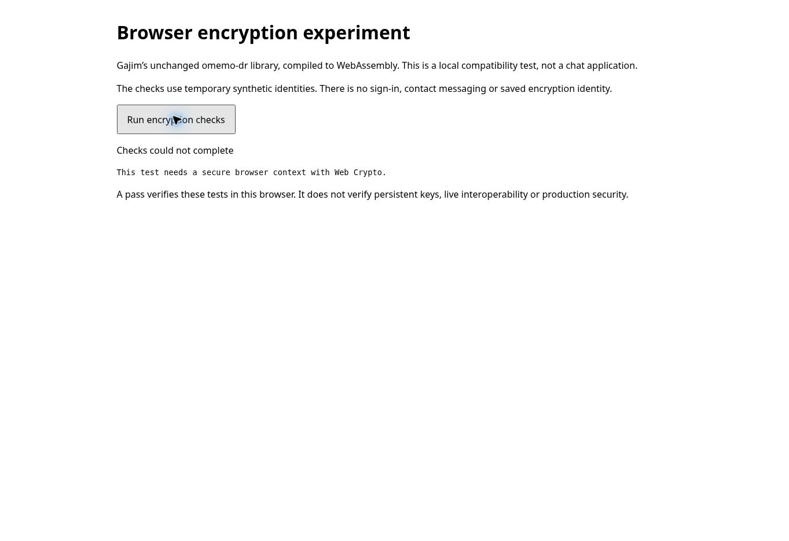

# Foundation validation — 2026-11-03

## Demonstrated

- Built the unchanged omemo-dr 1.2.0 C extension as `cp314-cp314-pyemscripten_2026_0_wasm32` and checked its actual WebAssembly magic bytes.
- Ran 8 unchanged upstream tests, 6 crypto checks and 9 Gajim storage checks in Pyodide 314.0.7, hosted by Node 24.22.1. **23 passed, 0 failed, 0 errors, 0 skipped.** [Current raw result](evidence/node-wasm-storage.json); [earlier 14-test M1 result](evidence/node-wasm.json).
- The nine storage checks also passed on native Python. They retain the device identity, prekeys, peer trust and working ratchets after reconstructing the stores/session managers; corrupt, missing, mismatched and unsupported snapshots are rejected.
- Passed all **16** JS repository tests against simulated IndexedDB and Node Web Locks, including quota/denied storage, concurrent writers, stale revisions, identity replacement attempts, lock timeout and an abort after the write request succeeds.
- Completed **three encrypted exchanges** through WASM, the adapted Gajim store and the JS repository with reconstructed objects. These combined checks use synthetic identities and explicit synthetic trust; no XMPP transport exists yet.
- Confirmed Python 3.14.2, cryptography 47.0.0, protobuf 7.34.1 and the loaded WASM curve-module path in the test result.
- Source archive, runtime files and runtime package hashes are checked before packaging. The crypto source remains unchanged. Gajim's original SQLite file is hash-checked, then adapted with three explicit substitutions recorded in [the storage patch ledger](storage.md).
- Fresh local builds and [the M1 GitHub Actions run](https://github.com/tobiko-dev/Monal/actions/runs/41624574387) produced the identical wheel SHA-256: `e3df1e9853a938f1d62ba9e4fce4d27fc82b003be6bcbf4c6c20999b12ebe9df`. The M2 local build retains that hash; storage code is packaged separately.
- The actual runner rejects altered `checks.zip` and `port.zip` archives at their hash-check boundary, restoring the originals afterwards.
- The generated harness is about 16.5 MB before transfer compression; the runtime and dependencies account for about 16.2 MB. This is asset size, not memory usage.
- One Node observation: runtime startup 1.75 seconds; package loading plus checks 1.77 seconds; the 14 tests themselves 0.75 seconds. These are observations in this Linux environment, not iPad performance estimates.

## Browser and device limits

The actual Chrome preview opened the harness, and pressing Run reached its explicit secure-context check. The provided preview uses `http://terminal.local:4173/`, which does not provide the required secure Web Crypto context. The worker therefore stopped before running the tests. No browser encryption pass is claimed, and browser security was not disabled.

A private HTTPS QA harness has now been deployed for browser checks. Its sign-in is pending authorization, so no authenticated browser result is recorded. Actual iPad Safari, reloads, real multi-tab behavior, startup/memory measurements and background/resume behavior remain pending. Node's simulated IndexedDB and real WASM execution do not substitute for those checks.

## Build issues resolved

1. The SDK's archive extraction initially tried to restore ownership IDs unsupported by the container. Build-time `TAR_OPTIONS=--no-same-owner` fixed this without changing compiler or crypto source.
2. A compiler wrapper selected the host's default Python 3.12 while using the Python 3.14 build environment. The build script now puts its own environment's binary directory first on PATH.
3. Command-line Git had read access but no push credentials. The branch is synchronized through the connected GitHub integration.

## Not implemented or proved

The snapshot store and per-operation concurrency adapter are implemented and tested as described above, but real browser lifecycle validation and the production worker boundary are incomplete. There is no fingerprint-verification UI, XMPP account authentication, 5july connection, Gajim/nbxmpp messaging integration, durable outbox, history, attachments, conversation UI or production security review. The M1 fixture's blind trust is test-only; the adapted Gajim store disables it.

No XMPP account login or real contact message was used. A library returning no ciphertext for an unknown or unverified peer is tested; app-wide enforcement of required OMEMO belongs to M3 and is not claimed here. Local identity bytes are not encrypted at rest by this increment. Prepared ciphertext and ratchet state still need a shared durable outbox transaction before a network send is implemented.
